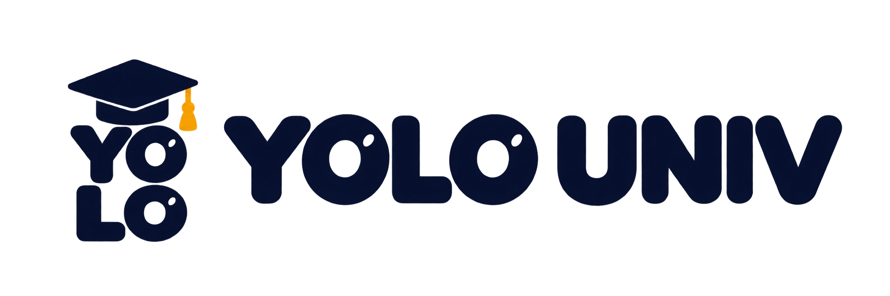

<p align="center">
  
</p>

<h1 align="center">YOLO UNIV — 졸업까지 자동사냥</h1>

<p align="center">
  경희대 LMS와 AI 에이전트를 연결해 공부의 편의를 높이고, ‘배운다는 것’의 의미를 묻는 macOS 앱<br>
  <sub>2026 AI·SW페스티벌 출품작 · 팀 LearningXXX</sub>
</p>

---

## 작품 소개

강의 자료를 내려받고, 녹음을 다시 듣고, 모르는 문장을 번역하고, 과제에 필요한 내용을 찾아 정리하는 일.
YOLO UNIV는 이 과정을 하나의 앱으로 연결합니다. 경희대 LMS의 자료와 강의 녹음·영상을 과목·주차별로 모으고,
**Claude Code**가 그 자료를 읽고 질문에 답하거나 학습 자료와 과제 초안을 만듭니다.

편리함을 끝까지 밀어붙이면 질문이 남습니다.
**“AI가 전문 지식으로 좋은 평가를 받는 결과물까지 만든다면, 인간은 무엇을 배워야 할까?”**
‘졸업까지 자동사냥’은 이 질문을 대학의 한 학기로 압축해 보여 주는 장치입니다.

같은 기능을 두 방식으로 쓸 수 있습니다.

| 선비(Prude) 모드 | YOLO 모드 |
|---|---|
| 자료 정리·설명·번역·복습으로 학생이 **직접 공부**하도록 돕습니다. | 결과물 제작부터 제출까지 **AI에 맡기며** 학생이 직접 하는 과정을 줄여 갑니다. |

## 주요 기능

앱은 **모으기 → 이해하기 → 만들기 → 맡기기** 순서로 이어집니다.

| 단계 | 할 수 있는 일 |
|---|---|
| **1. 모으기** | LMS 로그인 후 수강 과목 전체의 자료·공지·과제·강의계획서 자동 동기화, 주차별 정리, 내 파일 추가 · 대면 강의 녹음(일시정지·강제 종료 복구) · 온라인 강의 원본 받기 · Mac 안에서 자동 전사 |
| **2. 이해하기** | PDF 연속 보기와 선택 문장 번역·쉬운 설명 · 쪽 범위 PDF 번역본 만들기 · 전사문 교정·정리본·번역 · 과목·주차 자료를 근거로 답하는 채팅(파일 첨부·화면 캡처) · 과목·주차별 메모와 AI 정리 |
| **3. 만들기** | 과제 안내와 전 주차 자료를 읽는 과제 전용 채팅 · AI 과제 초안 미리보기 · 대화가 만든 파일을 앱 안에서 보기·되돌리기 |
| **4. 맡기기** | 시간표와 “지금·다음 수업” 첫 화면 · 할 일·진행 상태 정리와 자동화 범위 설정 · 공식 플레이어 시청·출석 상태 추적 · 퀴즈 상태 확인 · 전사·다운로드 작업 큐 |
| **화면** | 상단 바에서 라이트·다크 테마를 한 번에 전환, 설정에서 시스템 설정 따르기 선택(재시작 후에도 유지) |
| **앱 수정** | “이 버튼 이름을 바꿔 줘”처럼 말하면 별도 작업 공간에서 앱 코드를 고치고, 변경 확인 → 검증·빌드 → 재시작으로 적용합니다. 실패하면 정상 버전으로 되돌립니다. |

### 아직 main에 없거나 일부러 만들지 않은 것

- **진행 중:** 주차 설명 영상·과제 PDF/PPT 생성 엔진은 들어왔지만, 앱 화면과의 연결은 검토 중입니다. 과제 자동 제출은 실제 LMS에 제출 기록이 남는 문제가 있어 결정을 기다리고 있습니다.
- **만들지 않음:** 화면을 보지 않는 백그라운드 출석과 퀴즈 대리 응시는 구현하지 않았습니다. 학습 없이 이수 기록이 쌓이는 상황을 경고하는 **사고실험**으로만 제시합니다.

## 동작 방식

```text
 경희대 LMS (Canvas)
        │  각 학생이 자기 Mac에서 직접 로그인 · 수집 (서버 없음)
        ▼
 macOS 앱 (Electron)
  ├─ UI (React)     자료 뷰어 · 녹음/영상 · 전사 · 채팅 · 과제 · 메모
  ├─ Host (Node)    수집기 · 로컬 파일 저장 · 권한 · IPC 검증
  ├─ 전사           Qwen3-ASR(MLX) — 음성은 Mac 밖으로 나가지 않음
  └─ AI 실행        공식 Claude Code — 각자의 구독 로그인 사용
```

- **서버가 없습니다.** 자료·녹음·전사·대화는 모두 사용자의 Mac에 저장됩니다.
- **구독을 그대로 씁니다.** 각 사용자의 공식 Claude Code 구독 로그인과 플랜 사용량 한도로 동작하며, API 키나 공용 인증 서버를 쓰지 않습니다.
- **음성은 로컬에서 전사합니다.** 녹음이 끝나거나 영상을 받으면 Mac에서 바로 전사하고, 원본과 생성 결과를 나눠 보관합니다. 실패하면 원본을 그대로 둔 채 다시 시도합니다.
- **renderer는 샌드박스에서 실행됩니다.** 화면은 계약에 정의된 채널만 호출할 수 있고, host가 모든 요청을 다시 검증합니다.

## 기술 스택

| 영역 | 사용 기술 |
|---|---|
| 앱 | Electron, TypeScript, React, Vite |
| 데이터·계약 | Zod 기반 공동 계약 패키지, 로컬 파일(JSON) 저장 |
| AI | Claude Code (Claude Agent SDK, 구독 로그인) |
| 전사 | Qwen3-ASR (`mlx-qwen3-asr`, Apple Silicon) |
| PDF | pdf.js |
| 개발 환경 | pnpm 워크스페이스, Docker 공통 검사, GitHub Actions |

## 내려받아 실행하기 (v1.0.0)

[Releases](https://github.com/lostmostcost/LearningXXX/releases/tag/v1.0.0)에서 `YOLO-UNIV-1.0.0-arm64.dmg`를 받아 `YOLO UNIV`를 `Applications`로 옮기면 됩니다.
Apple Silicon Mac, macOS 13 이상, 로그인된 Claude Code가 필요합니다. 공증되지 않은 앱이라 처음 열 때
**시스템 설정 → 개인정보 보호 및 보안 → 그래도 열기**가 필요합니다. 설치·데이터 위치·백업·한계는
[v1.0.0 릴리스 문서](docs/releases/v1.0.0.md)에 있습니다.

## 직접 실행하기

**필요한 것:** Apple Silicon Mac, Node 24.22.2, pnpm 12.14.0, 로그인된 [Claude Code](https://claude.com/claude-code) 구독, 경희대 LMS 계정.

```sh
git clone https://github.com/lostmostcost/LearningXXX.git
cd LearningXXX
pnpm install
node apps/desktop/host/node_modules/electron/install.js
pnpm --filter @learningxxx/desktop-ui build
pnpm --filter @learningxxx/desktop-host start
```

자동 전사를 쓰려면 전사 엔진을 한 번 설치합니다. 시스템 Python이 아니라 앱 전용 가상환경에 설치되며, Mac 메모리에 맞는 모델(1.7B, 8GB 이하면 0.6B)을 받습니다.

```sh
services/transcriber/setup.sh
```

앱을 켠 뒤 “학교 로그인” 창에서 LMS에 로그인하면 수강 과목이 동기화됩니다.
LMS 계정은 반드시 본인 Mac에서 직접 입력하세요.

## 저장소 구조

```text
apps/desktop/ui/        # 화면 (React, renderer)
apps/desktop/host/      # Mac 권한 · IPC · 로컬 데이터 (Electron main)
packages/collector/     # LMS 수집
packages/cli-adapter/   # 공식 Claude Code 실행 · 세션
packages/app-modifier/  # 요청 기반 앱 코드 수정 · 검증 · 복구
packages/contracts/     # UI ↔ host 공동 데이터 계약
services/transcriber/   # 로컬 자동 전사 큐 · 엔진 설치
assets/branding/        # 로고 · 앱 아이콘
docs/                   # 기획 · 설계 · QA 기록
tests/                  # 합성 fixture · 도구 검사
```

## 개발 방식

Claude Code 에이전트와 함께 개발했습니다. 요구사항(PRD)과 작업 목록(WBS)을 먼저 정하고,
작업마다 영역을 선점해 충돌을 막고 브랜치 → 에이전트 자체 검토 → CI 통과 → PR 병합 순서로 진행했습니다.
주요 기능 단계에서는 실제 앱을 직접 써 보고 결과를 기록했습니다.

- [요구사항 (PRD-001)](docs/specs/PRD-001.md) · [아키텍처 (ARCH-001)](docs/specs/ARCH-001.md) · [로드맵](docs/specs/ROADMAP-001.md)
- [협업 규칙 (OPS-001)](docs/specs/OPS-001.md) · [에이전트 작업 규칙 (AGENTS.md)](AGENTS.md) · [개발 환경](docs/DEVELOPMENT.md)
- 자가 테스트 기록: [A 단계](docs/qa/WBS-020-a-self-test.md) · [B 단계](docs/qa/WBS-028-b-self-test.md) · [MVP 정리](docs/qa/WBS-029-mvp-summary.md)
- [작업 목록 (wbs.json)](docs/pm/wbs.json)

공통 검사:

```sh
docker compose run --rm tools
```

## 개인정보와 한계

- 강의 원본, 녹음, 쿠키, 계정 정보, Claude 인증 정보는 저장소에 넣지 않습니다. 테스트는 합성 자료만 사용합니다.
- 경희대 LMS 한 곳과 macOS(Apple Silicon)만 지원합니다.
- 전사 정확도와 8GB Mac에서의 속도는 아직 측정하지 않았습니다. 알려진 문제는 [MVP 정리](docs/qa/WBS-029-mvp-summary.md)에 있습니다.
- 개인 학습용 작품이며 경희대학교의 공식 서비스가 아닙니다.

## 팀

**LearningXXX** — 이문찬 ([@lostmostcost](https://github.com/lostmostcost))

개발 과정에서 안상현([@Kishibae](https://github.com/Kishibae))이 일부 기능 개발에 참여했습니다(공모전 참가자는 아님).
